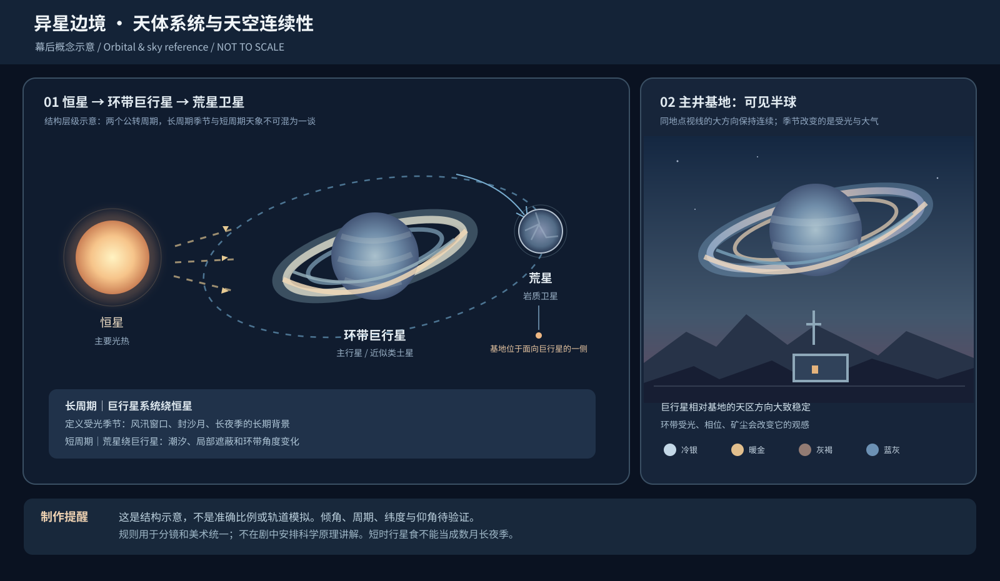
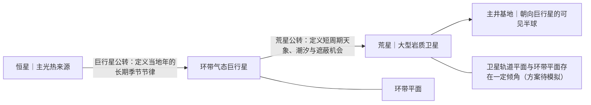

# 天体系统与天空连续性（幕后制作规则）

> **2026-10-24｜内部世界观与分镜、美术一致性依据。** **不是角色向观众讲解的资料**，禁止将本文件的名词、计算和科学论证直接变成剧情台词或解说。已确认的主从关系与未验证的几何参数分开记录；后续进行天体轨道模拟与视觉资产复核前，不锁死精确日历、周期、角度和距离。

返回：[星球环境](01_星球环境与生存规则.md) · [世界设定目录](../世界设定.md)

## 1. 正式确认的幕后事实

- **荒星是一颗大型岩质卫星**，环绕天空中那颗**拥有巨大环带的气态巨行星**运行；巨行星及其卫星一起绕一颗提供主要光热的恒星公转。人们口头仍称「荒星」「这颗星球」，台词不必改成天文学术语。
- 荒星有长期稳定、可供人类正常呼吸的大气，矿物荒原、少量绿洲与地下水脉、旧公司矿井和生物生态系统均保留；这不是突然改成宇宙真空或无生态的卫星。
- **巨行星、环带、荒星之间的轨道运动大体周期性、可计算**；巨行星引潮效应、恒星照明、行星反光及偶发遮蔽可以影响荒星的能量、局地液位与生物环境节拍。
- 气候并非由某个「环带颜色／行星位置」单独控制：**恒星季节光照 + 地形 + 大气环流 + 矿尘供给 + 局地水热**共同形成大尺度风汛及封沙月。阿岚依据旧天象历估计季节窗口，再根据地面风哨数据修正实际到达日和强度。
- 原生生命可能利用明暗、温度、水位和气压周期安排取食、闭合与迁徙，但不同物种有不同阈值；没有全星同时苏醒、虫群被环带行星远程操纵或精确「到点刷新」。
- **创作执行红线：规则对创作者可见，对观众隐身。** 通过环带与天光画面、广播渐变、植物闭合、居民作业与风塔运行让规律可被感受到；不给观众安排讲解公转、引潮、轨道倾角的课堂。

## 2. 内部轨道结构示意（概念图，非比例）

- **长周期：** 巨行星绕恒星的公转及系统倾斜状态，决定整年的受光季节背景；「当地一年」以此为基础。风汛与长夜季在这个长期循环中重复，但并非每个地点同一天发生。
- **短周期：** 荒星绕巨行星的运动带来潮汐节律与可能的行星遮蔽；环带的部分投影视角、阴影和亮边可跟着轨道位置改变。**短周期不能被硬改成每年只变化一次**。
- **天象与气象两层：** 阿岚可从旧天文历估计本季的大致窗口，但实际短沙、阵风、沙墙前沿仍须使用风速、气压、矿尘仪器实时判断。

## 3. 天空位置、摄影方向与环带姿态

**优先采用一个科学上较自然的制作基线：荒星已基本对巨行星潮汐锁定。** 卫星自转周期与绕巨行星轨道周期相近，因此巨行星在荒星面向它的半球上，长期停留于相近的**天空方位**，允许小幅天平动与可见姿态变化；背向半球则基本看不到它。

- **基地选址：** 主井基地设在能够长期望见巨行星的半球，并处于需要经历明显季节性日照变化的较高纬度区域。露台E09可见巨行星和宽阔环带，不会与后续长夜季矛盾。具体纬度和方位角**待三维轨道模型确认**；不要仅凭一张天空图规定它正好在头顶或全年不变。
- **固定场景的屏幕方向：** 同一处露台或广场的正反打、隔日同机位、两段分镜中，巨行星应保持大致相同的方位和合理的仰角；镜头改变朝向才改变它在画面中的屏幕位置。**不允许为了漂亮随意把行星移到另一侧天空**。
- **环带不是一圈发光的平面LOGO。** 行星环面接近巨行星赤道面；为让卫星看见开阔椭圆环带，**备选轨道应相对环面有适度倾角**。环带在不同卫星轨道相位可出现「张开、压扁、亮边、阴影」的周期变化，不能把环带倾角简单画成一年恒定从窄变宽。
- **物质与季节色：** 允许银白／冷蓝灰、暖香槟金、灰褐暗环、深蓝冷银等色温变化，成因优先选用**恒星光照角度、环粒子散射、行星本体大气、荒星大气和矿尘吸收**；不是固体环粒每季同步化学变色。封沙月能见度降低时，环带应被逐步遮蔽，而不是照常高清漂浮在沙幕前面。
- **另一颗小卫星的处理（美术决议）：** 参考资产《荒星地貌.jpg》右侧原本有两颗小天体，**正式制作最多保留其中一颗，默认方案为一颗偶尔出现的其他天然卫星；也允许某些版本将两颗全部移除**。它与荒星同绕巨行星，但拥有不同的轨道周期与轨道相位，**不像潮汐锁定条件下的主巨行星那样固定在基地天空**。它可随时间在天空中移动、升起落下、转至巨行星背后被遮蔽，或因相位、白天天光／尘雾而不可见；同一镜头的运动需连续，不能每个镜头随机瞬移、凭空闪现。单张定帧里看不到它是正常的，不强制每集出现。两颗小卫星不能在不同剧集中反复固定同一排列，也不能把它们当成另外两颗恒星或静止天幕贴图。
- **制作决策：** 现有《荒星地貌.jpg》继续作为行星与环带的原始视觉参考，**两颗小天体的数量不是必须沿用的视觉正典**。新画面的默认出图规范是“天空有主环带巨行星，可偶有**一颗**较小伴星”，不要求对旧原图立即重绘；如下一轮明确要修订这张资产，再另行制作新版本。
- **日夜连续性：** 即使巨行星在天上方位近似固定，**恒星仍会升落、行星相位和局部天光会变化**。被巨行星挡住恒星的短时遮蔽不是「持续数月的长夜季」。

## 4. 长夜季与气候：只定义能拍的因果

- **风汛（约一月）**是大尺度强风暴，其中部分相对稳定风段可用于风塔受控高效发电，阵风尖峰仍需减载。
- **封沙月（约一月）**是大范围浓矿尘、乱风向、静电和颗粒冲蚀危险，主风塔安全停机、太阳能几乎不能依靠。
- **长夜季（数月）**由荒星所在系统的长期受光季节、主井所处纬度的短昼效应及封沙后的高空浮尘共同造成。**幕后构型须提供实际可能的高纬季节性长期短昼／极短日照条件**；不能解释为巨行星遮挡恒星几个月。短暂天体遮蔽另算，不替代四季。
- **全年偶发短沙**不必每次与环带相位有直接关系；局地地形和天气即可触发，风哨日常预警仍有意义。

## 5. 待验证的设计参数（不是已经模拟出的科学结论）

| 选项 | 暂用工作方向 | 上屏和编剧边界 |
|---|---|---|
| 主星、巨行星 | 较稳定的恒星，类土星的有环气态巨行星处于适宜受热距离 | 不立即命名具体恒星质量、温度与绝对轨道长度 |
| 荒星 | 具有大气、较强重力、液态水局部存留的大型岩质卫星 | 可保留现有裸脸呼吸与生态；热量与大气稳定性后续计算 |
| 距离 | 最初可试算约 **8–12 个巨行星半径**的卫星轨道 | 仅供比例探索；潮汐加热、辐射、视直径及稳定区需评估 |
| 环面夹角 | 先探索**卫星轨道与环面约 10°–15° 倾角**的造型 | 只是一个建模假设；应检验轨道节点进动、长期稳定和可见宽度 |
| 轨道形状 | 低偏心率、尽可能避免强烈无端潮汐加热 | 不把热源写成永动的巨大地热发动机 |
| 基地纬度／自转 | 基地偏向巨行星可见侧、纬度较高；可采用近潮汐锁定 | 必须协同模拟季节、星体高度、长夜季，不在剧本中报数字 |
| 环带成分 | 倾向在温暖恒星距离仍可存在、或会被补充的**岩质／冰尘混合环** | 环的长期寿命、颗粒成分、阴影和色彩需科学顾问或进一步建模 |
| 系统年历 | 保留E02「几个月」、E08「一个多月」、E11「不足半个月」的宽松时间感 | 不锁14集之间精确天数，E09已定稿露台天空不改 |

任何精确的「一天几小时、一年多少天、日食每月几次、天体仰角几度、环带宽度几度」都应在建立动力学／摄影模型后统一，不靠临时对白填空。

## 6. 叙事过滤器：创作者需要知道，观众不需要上课

| 内部依据 | 观众真正看见或听见的东西 |
|---|---|
| 卫星几乎对巨行星潮汐锁定 | 主井露台同方向总能望见那颗庞然大物 |
| 年历与地面风场有统计关联 | 阿岚偶尔在背景电台提一句「风汛还有一个多月」 |
| 环面光照与散射改变观感 | 冷银到暖金、沙月暗淡、长夜冷色的天空变化 |
| 局地气压、水位和生物活动关联 | 莺注意覆膜林闭合时间，去查风哨记录 |
| 关键风段有风机额定范围 | 维克托逐步并网，风哨报阵风后减载停机 |
| 天象预测不等于天气绝对正确 | 阿岚修正沙墙时间，凯恩叫人回墙内 |

**禁止变成对白的内容：** 「我们是巨行星的同步卫星」「它的引潮强迫导致大气环流」「轨道倾角是十二度」「长夜季来自某次连续日食」。角色可以自然说「今夜外环亮」「风汛快到」「西边那片风不稳」，也可以抬头不说话。

## 7. 证据与科学参考（只供幕后）

- Heller & Barnes (2013), *Exomoon Habitability Constrained by Illumination and Tidal Heating*：卫星光照、巨行星反射／热辐射、食与潮汐加热的适居性约束。https://pmc.ncbi.nlm.nih.gov/articles/PMC3549631/
- NASA, *Iapetus*：土卫八的潮汐锁定与有倾角轨道使光环能斜向呈现。https://science.nasa.gov/saturn/moons/iapetus/
- NASA, *Hubble Views Saturn Ring-Plane Crossing*：环面受光和观察几何变化会使环显著变薄、变暗。https://science.nasa.gov/missions/hubble/hubble-views-saturn-ring-plane-crossing/
- Forgan & Dobos相关宜居卫星照明研究：长期气候还受光照、遮蔽、潮汐和行星自身辐射影响。https://academic.oup.com/mnras/article/441/4/3513/1208769

**科学审查状态：** 已参考研究建立*约束*，尚未进行精确N体轨道积分、热平衡与长期环带寿命验证。正式参数应等美术定天空朝向后再与动力学模型一并核实。
